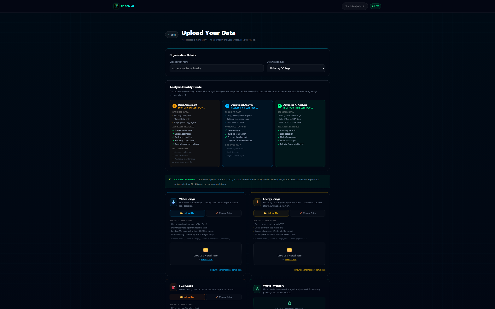
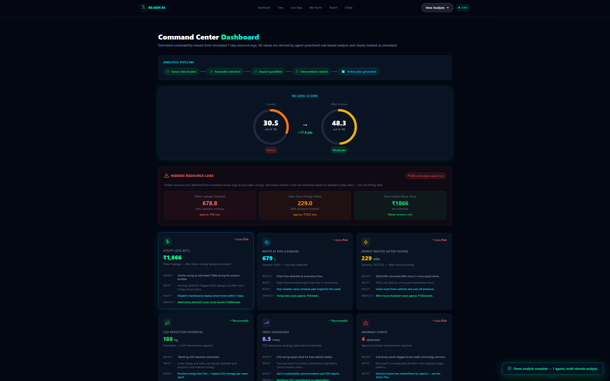
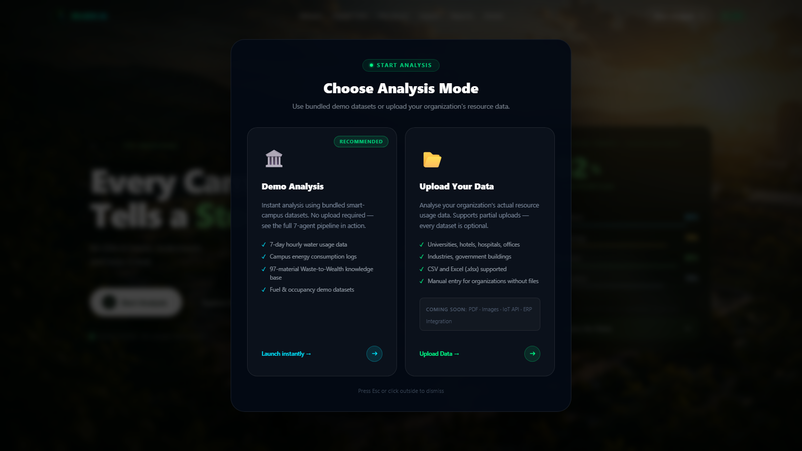
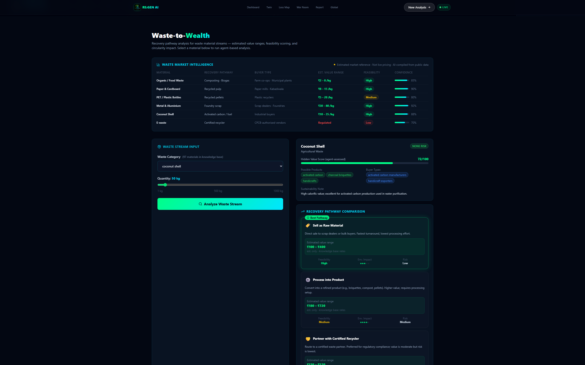
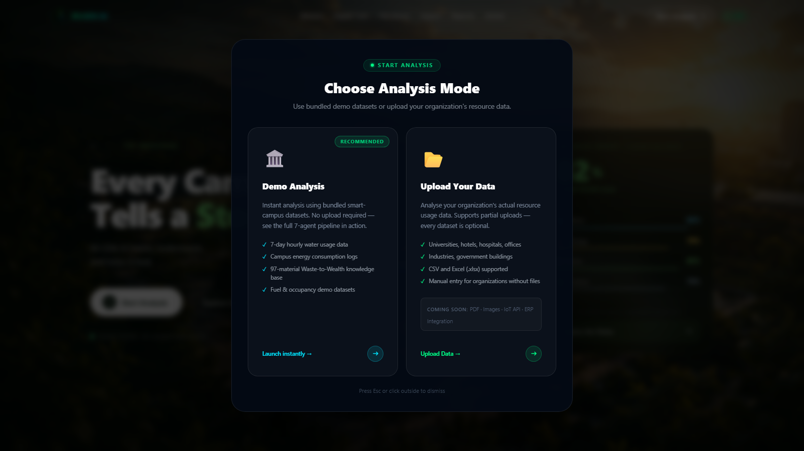

# RE:GEN AI

RE:GEN AI analyzes facility water, electricity, fuel and waste inventories. The React interface includes a synthetic campus demonstration, a private facility upload workflow and a Waste-to-Wealth recovery mission. The FastAPI application runs the existing Water Leakage, Energy Optimization, Waste-to-Wealth, Pollution & Impact, Decision Engine, RE:GEN Score, Benchmark and Report agents. See [PROGRESS.md](PROGRESS.md) for verification and acceptance status.

## Local setup on Windows

Local development and automated tests use SQLite. The test harness creates a fresh database in a temporary workspace directory. PostgreSQL, Docker and Supabase are unnecessary for these checks. Use Python 3.12 and Node 22.22.0. From the repository root:

```powershell
py -3.12 -m venv backend/.venv
backend/.venv/Scripts/python.exe -m pip install -r backend/requirements.txt
backend/.venv/Scripts/python.exe -m pytest backend/tests -q
cd backend
.venv/Scripts/python.exe -m uvicorn main:app --host 127.0.0.1 --port 8000
```

In a second PowerShell terminal:

```powershell
cd frontend
npm ci
npm run lint
npm run test
npm run build
npm run dev
```

Open the local Vite URL and select the simulated campus. Vite proxies `/api` to loopback. The notebook imports the same agent code and uses the bundled synthetic CSV files. Demo action controls simulate responses. Uploaded manual totals have no hourly observations. Analysis estimates and quoted recovery potential are distinct from confirmed handovers and realized receipts.

## Facility access

Configure a maintained OAuth/OIDC provider with an authorization-code public client, PKCE S256, an exact frontend redirect URI and HTTPS token/authorization endpoints. Set frontend build variables `VITE_OIDC_CLIENT_ID`, `VITE_OIDC_AUTHORIZE_URL`, `VITE_OIDC_TOKEN_URL` and, for separate hosting, `VITE_API_URL`. The browser keeps its access token in memory. Select facility upload to sign in.

Backend settings are listed in [backend/.env.example](backend/.env.example). Supply settings through the process environment. Configure `REGEN_AUTH_ISSUER`, `REGEN_AUTH_AUDIENCE` and `REGEN_AUTH_CERT_FILE` for the provider’s public RSA signing key. Rotate the public key in coordination with the issuer. Tokens need issuer, audience, subject, issue/expiry times and issuer-controlled `app_metadata.tenant_id` and `app_metadata.regen_role`. Restrict role provisioning to the institution. Viewers can read facility records, staff submit inventories and service evidence, and authorized adult facility administrators approve reservations and confirm handovers. Never grant staff or admin roles through user-editable profile fields.

Offline deterministic narration is the default. Optional local Ollama uses `REGEN_OLLAMA_MODEL` and loopback only. Gemini requires `REGEN_ENV=production`, the Gemini provider, an explicit model, a server-managed key and per-request `X-AI-Consent: yes`. Automated tests isolate the database and deny outbound network access. No provider credentials belong in the browser.

## API and evidence

FastAPI serves the route schemas under `/docs`. Facility staff can preview CSV/XLSX/JSON columns at `/upload/validate`, then submit files or manual totals at `/analyze/upload`. The optional preview parameter `column_mapping` maps input headers to canonical column names. Analysis accepts the same mappings keyed by dataset in `column_mappings`. Upload files are capped at 20 MiB each. The parser limits rows, columns and decompressed workbook size. Private history, JSON audit and PDF audit requests require a signed tenant token. Older analysis rows lack ownership and require an authorized offline review before attaching an owner.

Recovery missions use an idempotent request UUID, integer grams, INR paise and an Indian service PIN. The server stores decisions and typed evidence, including skipped agents, in the mission event list. Poll `GET /missions/{id}` to resume. Staff submit organization service evidence through `POST /recovery/services`. A different authorized administrator reviews it. Unreviewed, revoked, expired and incompatible services are excluded. Keep source documents and receipts in a facility-managed private store. Submit opaque evidence references only. No directory of real buyers is bundled. For locality display, an operator may import a manually reviewed, reuse-permitted postal CSV using `python -m core.schema --reviewed-postal-csv FILE`. Columns are `pin,locality,source_document,reuse_permission,reviewer,publication_date,reviewed_date`. Dates use ISO format. Missing locality evidence returns an unmapped status. Partner matching always requires explicit service PIN coverage. A public passport exposes accepted grams and handover status. Recycling requires further recipient evidence.

Register calibrated devices using `POST /devices` as an administrator. Provision the returned device token securely. Send small batches to `POST /devices/{id}/telemetry` with that device's bearer token. Supported inputs are cumulative litres, cumulative kWh and instantaneous kW with timezone-aware timestamps. The authenticated meter view shows raw values, reset/gap flags and integrated intervals at the registered zone. Parent/child balance requires synchronized intervals. Qualified personnel install and inspect real equipment.

## Facility recovery workflow

Submit a service PIN, material description, mass and condition. Mark composite or separate lots when a single catalogue match would be misleading. A facility administrator can answer the saved clarification, cite a supplier or inspection record, identify the intact material, or enter independently weighed lots that account for the whole inventory. Unresolved material stays in professional review. Each classified lot is scoped to this inventory. The private photo is available to authorized reviewers.

A verified service can represent repair, donation, internal reuse, industrial demand, a collective or a sale. Record actual capacity, costs, expiry and acceptance evidence. For a facility-visible business mailbox, submit an organization-managed role address and opt into publication. An independent administrator must record a publication confirmation on the review. Query `GET /recovery/directory/{pin}` with facility credentials. A submitter or administrator can withdraw via `DELETE /recovery/services/{id}/publication`. The relay queues internal tasks. Operators separately verify business identity, address control and actual service acceptance.

Gemini remains first when configured and consented. Optional loopback Ollama and optional production Groq follow. Set `REGEN_GROQ_MODEL` and provision the server-side secret named `GROQ_API_KEY` only through authorized deployment configuration. The mission checkbox permits sending material description and prior use for that request. Upload photos, PIN, contact details and evidence references are excluded from the material interpretation prompt. Human reviewers validate proposals before matching. Leave cloud consent and configuration disabled for local work.

Facility uploads may provide water_inr_per_litre or energy_inr_per_kwh together with tariff_reference. Explicit zero rates are retained.

Meters support W/kW, Wh/kWh and mL/L/m3, retain original units and timestamps, and can record an invoice-backed tariff in paise per canonical interval unit (L or kWh). A resource mission may name a registered meter; a reviewed work order from that meter can substantiate the recorded difference. Retention preview includes terminal missions and their economic outcomes. Active allocations require operator resolution before expiry.

## Deployment and rollback

1. Provision a private PostgreSQL database and distinct migration and application roles. Require TLS, restrict connectivity and configure backup retention with a tested restore. Set an explicit PostgreSQL SQLAlchemy `DATABASE_URL`. Production startup requires the migrated schema.
2. From `backend`, run `python -m core.schema` with the migration role on an authorized staging copy first. Revision 1 adds tables and preserves existing analysis rows. Use the application role with only DML, sequence and schema usage permissions when serving requests. For rollback, stop traffic, restore the pre-migration backup to a separate database, verify row counts and restore the matching application version before switching connections.
3. Serve FastAPI behind HTTPS with connection, time, body and rate limits at the proxy. Set exact `ALLOWED_ORIGINS`, prevent direct access to the origin and use shared rate enforcement for multi-worker deployments. The app rejects non-HTTPS production requests. Configure Uvicorn to trust forwarded scheme headers only from your proxy addresses. The app’s fallback limiter is process-local. Keep registration, signing keys, device credentials and backups in the facility’s access-control process.
4. Build the frontend with `npm ci` and `npm run build`. Configure its API and identity-provider origins explicitly. Hosted tiers can sleep or enforce quotas. Measure pilot traffic and provider limits before selecting a plan.
5. In staging, test a demo replay, signed upload, tenant-isolated audit, facility recovery mission and stale meter. Independently verify service coverage, actual receipt, calibrated hardware and restore behavior before approving a pilot. No public deployment has been authorized.

Facility administrators may delete analysis runs with `DELETE /history/runs/{analysis_id}`. Audit reads and deletion record the facility subject. For approved retention periods, run `python -m core.schema --retention-days DAYS` to count expired raw observations, owned runs and access logs. The additional `--apply-retention` flag deletes those expired rows. Agree retention periods for mission evidence, receipts and backups with the facility before pilot entry.

## Screenshots

### Landing Hero


*Entry point — live demo and upload mode options, with mission status and RE:GEN Score overview.*

---

### Upload Center



*Upload CSV, Excel, or manually enter water, energy, fuel, and waste data — every dataset is optional.*

---

### Command Center Dashboard



*Post-analysis key metrics: total wasted litres, kWh lost, CO₂ avoided, and RE:GEN Score across all resource domains.*

---

### Facility Visualisation


*Facility rendered at the correct analysis level — resource nodes (L1), zone archetypes (L2), or anomaly-driven map (L3).*

---

### Agent War Room



*Seven specialised agents — findings, confidence levels, and skip reasons all sourced from real backend data in upload mode.*

---

### Waste-to-Wealth



*Recovery pathway analysis across 97 materials — estimated value range, CO₂ savings, and regulatory compliance guidance.*

---

### Sustainability Action Plan



*Ranked intervention stack with estimated savings, export to PDF via browser print API.*

---

### Local Waste-to-Wealth development

From the repository root, run the API and frontend in separate PowerShell terminals.

```powershell
$env:REGEN_ENV='development'
$env:REGEN_DEV_IDENTITY='1'
$env:REGEN_DEMO_AI_PROVIDER='ollama'
$env:REGEN_OLLAMA_MODEL='qwen3:8b'
backend/.venv/Scripts/python.exe backend/scripts/local_demo.py
```

```powershell
$env:Path="$HOME/dev-tools/node-v22.22.0-win-x64;$env:Path"
$env:VITE_LOCAL_IDENTITY='1'
Set-Location frontend
npx.cmd npm@11.21.3 run dev -- --host 127.0.0.1 --port 15173 --strictPort
```

Open `http://127.0.0.1:15173`. The launcher creates a disposable SQLite database, starts the mission worker and uses a synthetic staff identity. Set `REGEN_DEMO_AI_PROVIDER=offline` for deterministic runs. Automated tests use independent fixtures.

Set `REGEN_MARKET_EVIDENCE_FILE` to an approved catalogue or `REGEN_MARKET_FEED_URL` to an operator-approved public HTTPS endpoint serving the same reviewed JSON schema. The feed request contains no inventory, account data, PIN or credentials. A reviewed entry supplies material, condition, category, compatible unit, INR rate range, observation date, HTTPS source, India-wide scope or exact service PINs and optionally costs. Use the existing market import staging script to review incoming evidence. Market records support estimates and eligible directory quotations expire independently.

Opt in to public geographic lookup with `REGEN_PUBLIC_DISCOVERY=1` and an approved organizational service contact in `REGEN_RESEARCH_CONTACT`. Confirm provider permission and deployment request volume before enabling. Public results require a material and pathway relevance signal. Use the reviewed postal table and tenant service directory when public lookup is disabled. Authorized adults or facility staff coordinate handovers.

#### Market and locality research activation

In the backend terminal, set `$env:REGEN_PUBLIC_MARKET_RESEARCH='1'` before running the local demo. The public ISS INDUSTRIES buying-rate page requires no account or API key. The connector fetches its dated rate block only when applicable and sends no inventory fields to ISS.

For broader market and service coverage, set `$env:REGEN_MATERIAL_RESEARCH_URL='https://your-approved-provider.example/recovery-research'` to your authorized structured HTTPS service. This is a provider endpoint placeholder. RE:GEN sends a bounded GET with `materials` (comma-separated plain material labels) and optional `pin`. Configure only a provider authorized to process those labels and PINs. A response contains `rates` using the reviewed market catalogue fields and `services` with `organization`, `material`, `pathways`, `service_pins`, `description` and `source_url`. Optional `conditions`, `unit`, `minimum_quantity` and `maximum_quantity` refine suitability. The provider must research and document its rates and service claims. User details and credentials do not belong in either payload. For a public unit valuation, supported bases are `gross_reference`, `avoided_purchase`, `refurbishment_cost`, `treatment_cost` and `output_revenue`. Output revenue requires a sourced `saleable_output_per_input_unit` and `output_unit`. Supply documented total transaction costs as `costs_inr` when known.

Before enabling geographic research, review the [Nominatim use policy](https://operations.osmfoundation.org/policies/nominatim/). For a single low-volume process with operator approval, set `$env:REGEN_PUBLIC_DISCOVERY='1'` and `$env:REGEN_RESEARCH_CONTACT='ops@your-organization.example'` using your authorized organizational contact. The app performs user-triggered PIN lookup only, uses a request interval and caches results. Do not use public endpoints for parallel deployments, bulk postcode processing or commercial-scale lookups. Set `REGEN_NOMINATIM_URL` and `REGEN_OVERPASS_URL` to your authorized hosted or self-managed HTTPS endpoints when applicable. Restart the backend after environment changes.

#### Indexed public search

For a no-key local smoke test, set `$env:REGEN_SEARCH_PROVIDER='mwmbl'` in the backend terminal before restarting the demo. Mwmbl's anonymous API is limited to one request per second and has a small index. RE:GEN does not retry rejected searches. Verify current usage limits before enabling it for a deployment. [Mwmbl API](https://developer.mwmbl.org/)

For an approved private SearXNG instance, configure its `search.formats` to include `json`, enable only upstream engines you are authorized to query and bind the instance to loopback. Point the local backend at that instance.

```powershell
$env:REGEN_SEARCH_PROVIDER='searxng'
$env:REGEN_SEARXNG_URL='http://127.0.0.1:18888/search'
```

Optional API adapters accept `REGEN_SEARCH_PROVIDER=brave` with `REGEN_BRAVE_API_KEY`, or `REGEN_SEARCH_PROVIDER=tavily` with `REGEN_TAVILY_API_KEY`. Configure the corresponding server-side key privately only after approving its plan and limits. [SearXNG JSON API](https://docs.searxng.org/dev/search_api.html) · [Brave authentication](https://api-dashboard.search.brave.com/documentation/guides/authentication) · [Tavily Search](https://docs.tavily.com/documentation/api-reference/endpoint/search)

Use `$env:REGEN_SEARCH_PROVIDERS='mwmbl,searxng'` to elect multiple providers after configuring them. Each submission researches up to three distinct material-and-condition combinations, with at most two searches per combination. A second configured provider or a different material-specific query is used when compatible evidence is missing. Duplicate URLs and query results are cached. Paid adapters participate only when explicitly named and privately configured.

`$env:REGEN_PUBLIC_MARKET_RESEARCH='1'` also enables Kabadify's [CC BY 4.0 Bengaluru rate feed](https://kabadify.com/rates), restricted to ordinary scrap grades and supported units in the [publisher's listed PINs](https://kabadify.com/about). The card reports indicative gross payout. Minimum quantity, fees and net value remain subject to the publisher's conditions.

Search sends eligible plain material labels and purpose terms to the selected provider. SearXNG, Brave and Tavily can also receive the requested PIN. Mwmbl uses broader India queries due to its sparse index. Search result URLs are only cited. The backend never fetches those pages. For automated numerical estimates, add individually reviewed domains to `REGEN_SEARCH_RATE_HOSTS`. The indexed text must explicitly bind the date, material, condition, purchase rate, unit and PIN in a single rate entry. Review publisher reuse rules and expected evidence format before adding a domain. General search covers up to three eligible items per submission. Remaining items keep their existing recovery and catalogue guidance.

Public Nominatim/Overpass lookup remains a separate opt-in using an authorized organizational contact. Search leads with an indexed business location or unknown service area never establish collection coverage, travel distance or an eligible offer.


## Controlled hosted demonstration checkpoint

GitHub publication is pending repository-local author configuration, Git HTTPS login and confirmation that pushes to `engineering-reconstruction` create previews. An existing Vercel deployment was observed for project `frontend` on main. The hosting branch settings and an authorized staging backend/database remain unverified.

The frontend Vercel configuration runs `npm ci` and `npm run build`. Set build variables `VITE_API_URL`, `VITE_OIDC_CLIENT_ID`, `VITE_OIDC_AUTHORIZE_URL` and `VITE_OIDC_TOKEN_URL` for the exact preview origin and an authorized HTTPS backend. The static frontend requires an API target because its Vercel files do not supply an API proxy.

For the backend, use the existing Docker image or an equivalent persistent Python service. Configure `REGEN_ENV=production`, a private PostgreSQL `DATABASE_URL`, exact `ALLOWED_ORIGINS`, `REGEN_AUTH_ISSUER`, `REGEN_AUTH_AUDIENCE` and a mounted public verification certificate at `REGEN_AUTH_CERT_FILE`. Run `python -m core.schema` with authorized migration access before API and worker startup. Run `python scripts/mission_worker.py` as a separate worker using the same database and authorization configuration. Probe `/health` and `/ready`. HTTPS proxy trust must match the hosting proxy.

Use `REGEN_AI_PROVIDER=offline` for a quota-free hosted demonstration. To activate authorized production Gemini later, configure `REGEN_AI_PROVIDER=gemini`, `GEMINI_MODEL` and private `GEMINI_API_KEY`; cloud requests still require tenant authorization and consent. Laptop Ollama remains local. Keep `REGEN_DEV_IDENTITY` and `VITE_LOCAL_IDENTITY` unset for hosted environments.

Existing Compose defines PostgreSQL, migration, API, worker and Nginx services for a controlled environment. It binds the frontend to localhost and needs a separately configured HTTPS ingress for hosting. Persistent database storage, worker runtime and hosting costs must be checked in the existing account before provisioning. Render deployment settings are unavailable in the repository and no Render service was verified.

Production remains on HOLD pending college authorization, calibrated meters or approved gateway access, documented tariffs/factors, backup restore verification and documented intervention outcomes.
